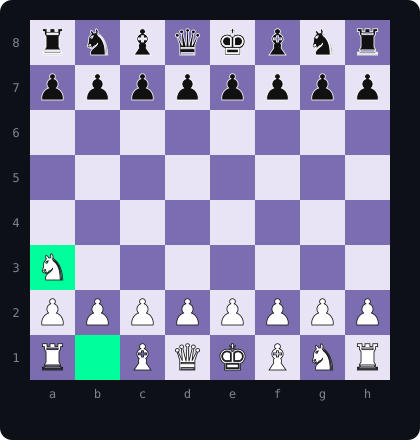
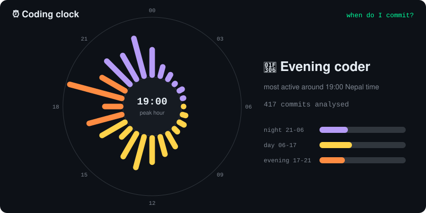

<!-- Header -->
<p align="center">
  
</p>

<p align="center">
  <a href="https://git.io/typing-svg">
    
  </a>
</p>

<p align="center">
  <a href="https://www.charitrashrestha.com.np/"></a>
  <a href="https://www.linkedin.com/in/charitra-shrestha-78245b270/"></a>
  <a href="mailto:code@charitrashrestha.com.np"></a>
  <a href="https://dev.to/charitraa"></a>
  <a href="https://www.youtube.com/@NooeHack"></a>
  <a href="https://www.instagram.com/_charitraa_/"></a>
  <a href="https://twitter.com/ROYALXGAMER9"></a>
</p>

<p align="center">
  
  <a href="https://wakatime.com/@8b338e0c-5f4d-4b55-9596-6a45dec526a1"></a>
  <a href="https://leetcode.com/u/charitraa/"></a>
</p>

---

### `> cat about.md`

```bash
charitra@kathmandu:~$ whoami
  name      : Charitra Shrestha
  role      : Software Developer @ YakshaSoft  (web + mobile)
  degree    : BSc (Hons) Computer Science & Software Engineering, University of Bedfordshire
  focus     : full-stack development, web security, automation
  building  : NepLang  ·  EducationERP  ·  AI-powered content pipelines
  off-duty  : football ⚽  music 🎧  making Linux tutorials on YouTube 🐧

charitra@kathmandu:~$ echo $CONTACT
  code@charitrashrestha.com.np   |   ask me anything → github.com/charitraa/charitraa/issues
```

---

### `> ls ~/projects --featured`

<table>
  <tr>
    <td width="50%" valign="top">
      <h4>🇳🇵 <a href="https://github.com/charitraa/Nepa">NepLang</a></h4>
      A small programming language for Nepali developers, with keywords in romanized Nepali.<br/>
      
      
    </td>
    <td width="50%" valign="top">
      <h4>🏫 EducationERP</h4>
      A modular school ERP: students, academics, finance and HR, as an
      <a href="https://github.com/charitraa/EducationERPApi">API</a>, an
      <a href="https://github.com/charitraa/EducationERPAdmin">admin portal</a> and a
      <a href="https://github.com/charitraa/EducationERPStudent">student app</a>.<br/>
      
      
      
    </td>
  </tr>
  <tr>
    <td width="50%" valign="top">
      <h4>🤖 Nooe Knows: AI video pipeline</h4>
      One animated story a day, written, checked, animated in Three.js and scheduled to four platforms by a GitHub Actions + Claude pipeline.
      <a href="https://www.youtube.com/@Nooe_Films">Watch the channel</a>.<br/>
      
      
      
    </td>
    <td width="50%" valign="top">
      <h4>✍️ <a href="https://github.com/charitraa/Blog_Server">Mindful Blog</a></h4>
      Full-stack blog with a Django REST backend and a daily, AI-written post that publishes itself.<br/>
      
      
    </td>
  </tr>
  <tr>
    <td width="50%" valign="top">
      <h4>🐍 <a href="https://github.com/charitraa/Python_Script">Python_Script</a></h4>
      A collection of Python scripts that grows every day, generated and sorted automatically.<br/>
      
      
    </td>
    <td width="50%" valign="top">
      <h4>🌐 <a href="https://www.charitrashrestha.com.np/">charitrashrestha.com.np</a></h4>
      My portfolio: projects, writing and contact, built with TypeScript.<br/>
      
      
    </td>
  </tr>
</table>

---

### `> cat ~/.stack`

<p align="center">
  <br/>
  <br/>
  
</p>

---

### `> top --user charitraa`

<p align="center">
  
</p>

### `> uptime --coding`


<!--START_SECTION:waka-->

```txt
From: 28 October 2026 - To: 04 November 2026

Total Time: 3 hrs 44 mins

Python     1 hr 35 mins          ██████████▓░░░░░░░░░░░░░░   42.61 %
JSON       1 hr 9 mins           ███████▓░░░░░░░░░░░░░░░░░   30.84 %
Markdown   52 mins               ██████░░░░░░░░░░░░░░░░░░░   23.62 %
Bash       6 mins                ▓░░░░░░░░░░░░░░░░░░░░░░░░   02.93 %
```

<!--END_SECTION:waka-->

---

### `> neofetch && ./galaxy`

<!-- Profile art: every image below is redrawn from live GitHub stats every 6 hours by .github/workflows/profile-art.yml.
     To remove one, delete its block from ART:name to /ART:name (and its function in gen/build.py if you like). -->

<!-- ART:terminal -->
<p align="center"><picture><source media="(prefers-color-scheme: light)" srcset="art/terminal-light.svg"/></picture></p>
<!-- /ART:terminal -->

<!-- ART:galaxy -->
<p align="center"></p>
<!-- /ART:galaxy -->

---

### `> play --with-visitors`

<!-- Visitor games: each link opens an issue; .github/workflows/interact.yml makes the move and updates this README.
     Remove any game by deleting its block from GAME:name to /GAME:name. -->

<!-- GAME:chess -->
#### ♟️ Community chess
<!-- CHESS:START -->
<p align="center"><picture><source media="(prefers-color-scheme: light)" srcset="art/chess-light.svg"/></picture></p>

<p align="center">It's <b>White ⚪</b>'s turn, move 1. Anyone can play either side: click a move below.</p>

| Piece | Your move |
|---|---|
| **Pawn** | [a3](https://github.com/charitraa/charitraa/issues/new?title=chess%3A%20move%20a2a3&body=Just%20press%20%22Submit%20new%20issue%22.%20The%20README%20updates%20in%20about%20a%20minute.) [a4](https://github.com/charitraa/charitraa/issues/new?title=chess%3A%20move%20a2a4&body=Just%20press%20%22Submit%20new%20issue%22.%20The%20README%20updates%20in%20about%20a%20minute.) [b3](https://github.com/charitraa/charitraa/issues/new?title=chess%3A%20move%20b2b3&body=Just%20press%20%22Submit%20new%20issue%22.%20The%20README%20updates%20in%20about%20a%20minute.) [b4](https://github.com/charitraa/charitraa/issues/new?title=chess%3A%20move%20b2b4&body=Just%20press%20%22Submit%20new%20issue%22.%20The%20README%20updates%20in%20about%20a%20minute.) [c3](https://github.com/charitraa/charitraa/issues/new?title=chess%3A%20move%20c2c3&body=Just%20press%20%22Submit%20new%20issue%22.%20The%20README%20updates%20in%20about%20a%20minute.) [c4](https://github.com/charitraa/charitraa/issues/new?title=chess%3A%20move%20c2c4&body=Just%20press%20%22Submit%20new%20issue%22.%20The%20README%20updates%20in%20about%20a%20minute.) [d3](https://github.com/charitraa/charitraa/issues/new?title=chess%3A%20move%20d2d3&body=Just%20press%20%22Submit%20new%20issue%22.%20The%20README%20updates%20in%20about%20a%20minute.) [d4](https://github.com/charitraa/charitraa/issues/new?title=chess%3A%20move%20d2d4&body=Just%20press%20%22Submit%20new%20issue%22.%20The%20README%20updates%20in%20about%20a%20minute.) [e3](https://github.com/charitraa/charitraa/issues/new?title=chess%3A%20move%20e2e3&body=Just%20press%20%22Submit%20new%20issue%22.%20The%20README%20updates%20in%20about%20a%20minute.) [e4](https://github.com/charitraa/charitraa/issues/new?title=chess%3A%20move%20e2e4&body=Just%20press%20%22Submit%20new%20issue%22.%20The%20README%20updates%20in%20about%20a%20minute.) [f3](https://github.com/charitraa/charitraa/issues/new?title=chess%3A%20move%20f2f3&body=Just%20press%20%22Submit%20new%20issue%22.%20The%20README%20updates%20in%20about%20a%20minute.) [f4](https://github.com/charitraa/charitraa/issues/new?title=chess%3A%20move%20f2f4&body=Just%20press%20%22Submit%20new%20issue%22.%20The%20README%20updates%20in%20about%20a%20minute.) [g3](https://github.com/charitraa/charitraa/issues/new?title=chess%3A%20move%20g2g3&body=Just%20press%20%22Submit%20new%20issue%22.%20The%20README%20updates%20in%20about%20a%20minute.) [g4](https://github.com/charitraa/charitraa/issues/new?title=chess%3A%20move%20g2g4&body=Just%20press%20%22Submit%20new%20issue%22.%20The%20README%20updates%20in%20about%20a%20minute.) [h3](https://github.com/charitraa/charitraa/issues/new?title=chess%3A%20move%20h2h3&body=Just%20press%20%22Submit%20new%20issue%22.%20The%20README%20updates%20in%20about%20a%20minute.) [h4](https://github.com/charitraa/charitraa/issues/new?title=chess%3A%20move%20h2h4&body=Just%20press%20%22Submit%20new%20issue%22.%20The%20README%20updates%20in%20about%20a%20minute.) |
| **Knight** | [Na3](https://github.com/charitraa/charitraa/issues/new?title=chess%3A%20move%20b1a3&body=Just%20press%20%22Submit%20new%20issue%22.%20The%20README%20updates%20in%20about%20a%20minute.) [Nc3](https://github.com/charitraa/charitraa/issues/new?title=chess%3A%20move%20b1c3&body=Just%20press%20%22Submit%20new%20issue%22.%20The%20README%20updates%20in%20about%20a%20minute.) [Nf3](https://github.com/charitraa/charitraa/issues/new?title=chess%3A%20move%20g1f3&body=Just%20press%20%22Submit%20new%20issue%22.%20The%20README%20updates%20in%20about%20a%20minute.) [Nh3](https://github.com/charitraa/charitraa/issues/new?title=chess%3A%20move%20g1h3&body=Just%20press%20%22Submit%20new%20issue%22.%20The%20README%20updates%20in%20about%20a%20minute.) |

**Last moves:** no moves yet: be the first!  
**Top players:** nobody yet  
Games finished: 0
<!-- CHESS:END -->
<!-- /GAME:chess -->

<!-- GAME:riddle -->
#### 🎯 Daily riddle
<!-- RIDDLE:START -->
> 🎯 **Today's riddle (2026-11-06):** Forward I am heavy, backward I am not. What am I?

**[💡 Answer it](https://github.com/charitraa/charitraa/issues/new?title=riddle%3A%20answer%20&body=Type%20your%20answer%20at%20the%20end%20of%20the%20issue%20title%2C%20after%20riddle%3A%20answer)** (type your answer after `riddle: answer` in the title) · solved today by 0

🏆 **Hall of fame:** nobody yet
<!-- RIDDLE:END -->
<!-- /GAME:riddle -->

<!-- GAME:poll -->
#### 🗳️ Live poll
<!-- POLL:START -->
**What should I build next?** (0 votes)

| Option | Votes | |
|---|---|---|
| 1. NepLang 2.0: more Nepali keywords | `▱▱▱▱▱▱▱▱▱▱` 0% (0) | [vote](https://github.com/charitraa/charitraa/issues/new?title=poll%3A%20vote%201&body=Just%20press%20%22Submit%20new%20issue%22.%20The%20README%20updates%20in%20about%20a%20minute.) |
| 2. More Linux fix videos on Nooe Hack | `▱▱▱▱▱▱▱▱▱▱` 0% (0) | [vote](https://github.com/charitraa/charitraa/issues/new?title=poll%3A%20vote%202&body=Just%20press%20%22Submit%20new%20issue%22.%20The%20README%20updates%20in%20about%20a%20minute.) |
| 3. An open-source EducationERP demo | `▱▱▱▱▱▱▱▱▱▱` 0% (0) | [vote](https://github.com/charitraa/charitraa/issues/new?title=poll%3A%20vote%203&body=Just%20press%20%22Submit%20new%20issue%22.%20The%20README%20updates%20in%20about%20a%20minute.) |
| 4. A VS Code theme in my neon colours | `▱▱▱▱▱▱▱▱▱▱` 0% (0) | [vote](https://github.com/charitraa/charitraa/issues/new?title=poll%3A%20vote%204&body=Just%20press%20%22Submit%20new%20issue%22.%20The%20README%20updates%20in%20about%20a%20minute.) |

One vote per GitHub account; voting again moves your vote.
<!-- POLL:END -->
<!-- /GAME:poll -->

<!-- GAME:guestbook -->
#### 📝 Guestbook
<!-- GUESTBOOK:START -->
_No signatures yet. Be the first!_

**[✍️ Sign the guestbook](https://github.com/charitraa/charitraa/issues/new?title=guestbook%3A%20sign&body=Write%20your%20message%20on%20the%20first%20line%20%28max%2080%20characters%29.%20Links%20and%20formatting%20are%20removed.)** · 0 signatures so far
<!-- GUESTBOOK:END -->
<!-- /GAME:guestbook -->

---

### `> analyze --me`

<!-- ART:clock -->
<p align="center"><picture><source media="(prefers-color-scheme: light)" srcset="art/clock-light.svg"/></picture></p>
<!-- /ART:clock -->

<!-- ART:journey -->
<p align="center"><picture><source media="(prefers-color-scheme: light)" srcset="art/journey-light.svg"/></picture></p>
<!-- /ART:journey -->

<!-- ART:mood -->
<p align="center"><picture><source media="(prefers-color-scheme: light)" srcset="art/mood-light.svg"/></picture></p>
<!-- /ART:mood -->

<!-- ART:city -->
<p align="center"><picture><source media="(prefers-color-scheme: light)" srcset="art/city-light.svg"/></picture></p>
<!-- /ART:city -->

---

### `> ./snake --eat contributions`

<p align="center">
  <picture>
    <source media="(prefers-color-scheme: dark)" srcset="https://raw.githubusercontent.com/charitraa/charitraa/manual-run-output/only-svg/github-contribution-grid-snake-dark.svg" />
    <source media="(prefers-color-scheme: light)" srcset="https://raw.githubusercontent.com/charitraa/charitraa/manual-run-output/only-svg/github-contribution-grid-snake.svg" />
    
  </picture>
</p>

<p align="center">
  
</p>


